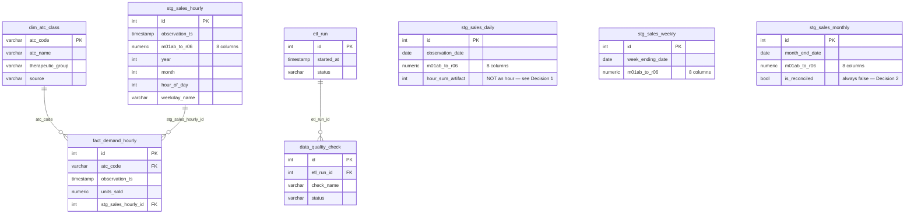

# Data Model

## Architecture

```
Kaggle Dataset (milanzdravkovic/pharma-sales-data)
        |
        v
Raw CSV Files (data/raw/ — immutable, never modified)
        |
        v
Staging  (stg_sales_hourly, stg_sales_daily, stg_sales_weekly, stg_sales_monthly
          — one table per source file, same wide shape as the CSV, full fidelity)
        |
        v
Validation  (schema / dtype / date / null / duplicate / range checks,
             + cross-granularity reconciliation — see docs/data-quality-decisions.md)
        |
        v
Transformation  (type casting, column renaming, melt wide -> long for the
                 canonical layer — app/etl/transform.py)
        |
        v
Canonical Analytical Model  (fact_demand_hourly + dim_atc_class — built
                             ONLY from stg_sales_hourly)
        |
        v
PostgreSQL
        |
        v
Analytics / ML / Optimization (M3+)
```

## Why hybrid, not "all four tables" and not "one merged table"

Per docs/data-quality-decisions.md (Decision 2): `salesdaily` reconciles
exactly with `saleshourly`, `salesweekly` reconciles exactly with
`salesdaily`, but `salesmonthly` does **not** reconcile with the others
(61/560 cells mismatched, a real source defect concentrated at the Jan/Feb
2017 boundary). Given that:

- **A single merged table across all 4 files was rejected outright** — it
  would either double-count (naively unioning all four grains) or silently
  paper over the monthly file's defect by averaging it in with trustworthy
  data.
- **Four fully independent tables, each queried separately, was also
  rejected** — daily/weekly/monthly would still just be reflections of the
  same underlying hourly transactions; treating them as independent tables
  invites exactly the double-counting risk the M2 instructions call out.
- **The chosen hybrid:** all four source files are loaded into their own
  staging table (nothing is discarded — full audit trail, full source
  fidelity, and the reconciliation checks stay re-runnable forever). But
  only ONE of them — `stg_sales_hourly`, the finest and only fully
  independently-verified-consistent grain — feeds the canonical analytical
  model. Daily/weekly/monthly analytics are then produced as **SQL views
  over the canonical fact table**, not by reading the staging tables, so
  there is exactly one arithmetic path from raw hours to any aggregate,
  and it's provably consistent (see reconciliation checks in
  `app/etl/validate.py`).

## Tables

### `dim_atc_class` (dimension, static reference)

| Column | Type | Constraints | Notes |
|---|---|---|---|
| `atc_code` | VARCHAR(10) | **PK** | e.g. `M01AB` |
| `atc_name` | VARCHAR(255) | NOT NULL | External WHO ATC reference — see docs/01-data-dictionary.md |
| `therapeutic_group` | VARCHAR(255) | NOT NULL | External WHO ATC reference |
| `source` | VARCHAR(50) | NOT NULL, default `external_who_atc_reference` | Documents that name/group are annotation, not observed data |
| `created_at` | TIMESTAMP | NOT NULL, default now() | |

Seeded once from `app/etl/reference_data.py`, upserted (never deleted) on
every ETL run.

### `stg_sales_hourly` (staging, canonical base grain)

Temporal grain: 1 row per hour. Mirrors `saleshourly.csv` 1:1.

| Column | Type | Constraints |
|---|---|---|
| `id` | INTEGER | **PK**, autoincrement |
| `datum_raw` | VARCHAR(30) | NOT NULL — original string, unparsed |
| `observation_ts` | TIMESTAMP | NOT NULL, **UNIQUE** |
| `m01ab` … `r06` (8 cols) | NUMERIC(12,4) | NOT NULL |
| `year`, `month`, `hour_of_day` | INTEGER | NOT NULL |
| `weekday_name` | VARCHAR(20) | NOT NULL |
| `loaded_at` | TIMESTAMP | NOT NULL, default now() |

Index: `ix_stg_sales_hourly_ts (observation_ts)`.

### `stg_sales_daily` / `stg_sales_weekly` / `stg_sales_monthly` (staging, audit-only)

Same shape pattern as above, mirroring their respective CSVs. Grain: 1 row
per day / ISO-ish (Sunday-ending) week / calendar month respectively.
Notable columns:

- `stg_sales_daily.hour_sum_artifact` (INTEGER, NOT NULL) — the source
  `Hour` column, renamed to document that it is an aggregation artifact,
  **not** an hour value (Decision 1).
- `stg_sales_monthly.is_reconciled` (BOOLEAN, NOT NULL, default `false`) —
  always `false`; documents Decision 2 in the schema itself, not just in
  prose.

None of these three feed the canonical model directly.

### `fact_demand_hourly` (canonical analytical model)

Temporal grain: 1 row per (ATC class, hour). Built only from
`stg_sales_hourly`, melted from wide (8 product columns) to long (one row
per class).

| Column | Type | Constraints |
|---|---|---|
| `id` | INTEGER | **PK**, autoincrement |
| `atc_code` | VARCHAR(10) | NOT NULL, **FK -> dim_atc_class.atc_code** |
| `observation_ts` | TIMESTAMP | NOT NULL |
| `units_sold` | NUMERIC(12,4) | NOT NULL, `CHECK (units_sold >= 0)` |
| `year`, `month`, `hour_of_day` | INTEGER | NOT NULL, `CHECK (hour_of_day BETWEEN 0 AND 23)` |
| `weekday_name` | VARCHAR(20) | NOT NULL |
| `stg_sales_hourly_id` | INTEGER | NOT NULL, **FK -> stg_sales_hourly.id** (traceability to the exact source row) |
| `loaded_at` | TIMESTAMP | NOT NULL, default now() |

Constraints: `UNIQUE (atc_code, observation_ts)` — one observation per
class per hour, enforced at the DB level, not just assumed.
Indexes: `ix_fact_demand_hourly_ts (observation_ts)`,
`ix_fact_demand_hourly_atc_ts (atc_code, observation_ts)`.

### `etl_run` / `data_quality_check` (pipeline metadata)

| `etl_run` column | Type | Notes |
|---|---|---|
| `id` | INTEGER PK | |
| `started_at` / `finished_at` | TIMESTAMP | `finished_at` NULL while running |
| `status` | VARCHAR(20) | `running` / `success` / `failed` |
| `source_dataset_identifier` | VARCHAR(100) | `milanzdravkovic/pharma-sales-data` |
| `notes` | TEXT | nullable |

| `data_quality_check` column | Type | Notes |
|---|---|---|
| `id` | INTEGER PK | |
| `etl_run_id` | INTEGER, FK -> etl_run.id | |
| `check_name` | VARCHAR(100) | e.g. `reconciliation_monthly_vs_daily` |
| `file_name` | VARCHAR(50), nullable | |
| `status` | VARCHAR(10) | `pass` / `fail` / `warn` |
| `details_json` | TEXT | JSON-serialized check details (kept as TEXT rather than a native JSON/JSONB column — deliberate simplicity choice, see docs/etl.md) |
| `checked_at` | TIMESTAMP | |

Index: `ix_data_quality_check_run (etl_run_id)`.

## ER diagram



`stg_sales_daily`, `stg_sales_weekly`, `stg_sales_monthly` have no FK
relationship into the canonical model — they are audit-only, deliberately
disconnected from `fact_demand_hourly` (see hybrid-architecture rationale
above).

## Analytical views

Defined in the initial Alembic migration
(`backend/app/db/migrations/versions/0001_initial_schema.py`), all three
computed **exclusively from `fact_demand_hourly`** so they cannot
double-count:

- `vw_demand_daily(atc_code, observation_date, units_sold, n_hours_observed)`
- `vw_demand_weekly(atc_code, week_ending_date, units_sold)` — Sunday-ending
  trailing week, matching the source convention verified in Decision 2.
- `vw_demand_monthly(atc_code, month_start_date, units_sold)` — uses
  **month-start**, not the source's month-end convention, deliberately, to
  avoid any implication that this rollup is "the same" as the untrusted
  `salesmonthly.csv` file.

**Not yet verified against a live Postgres instance** — no DB credentials
were available this milestone (see the M2 completion report). Verified
structurally via `Base.metadata.create_all()` against SQLite in the test
suite, which does not execute the Postgres-specific view SQL.
